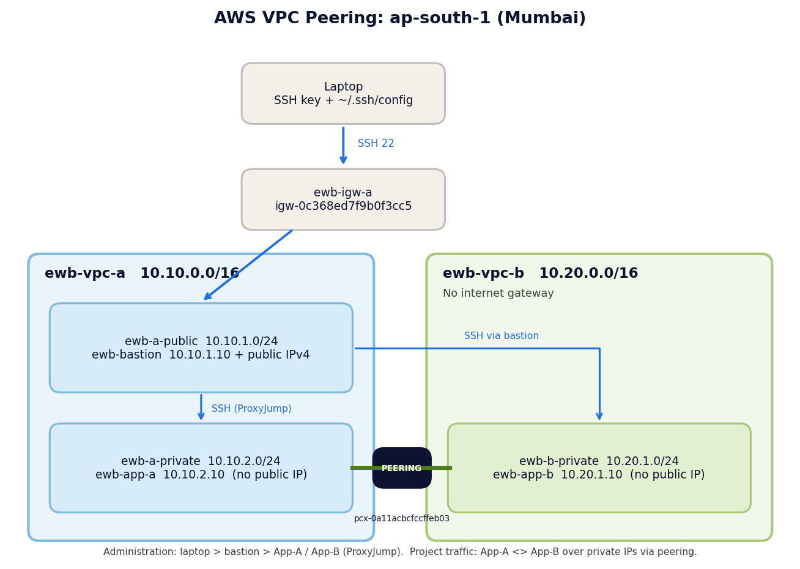
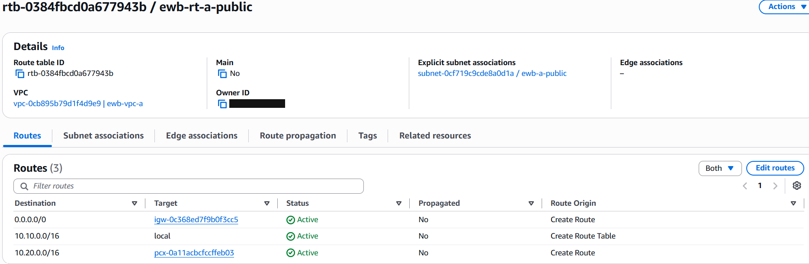
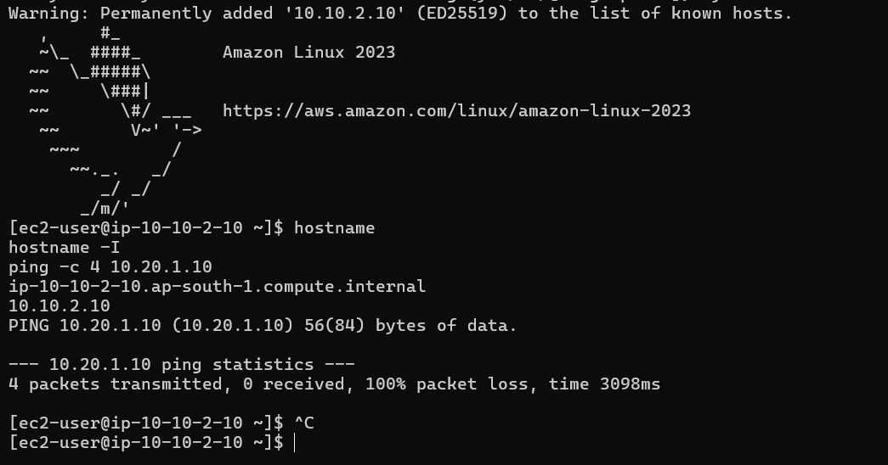
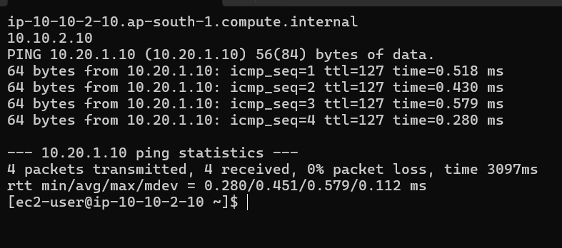
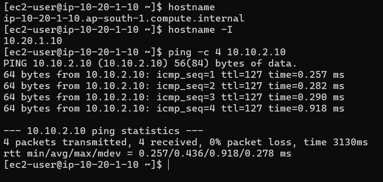
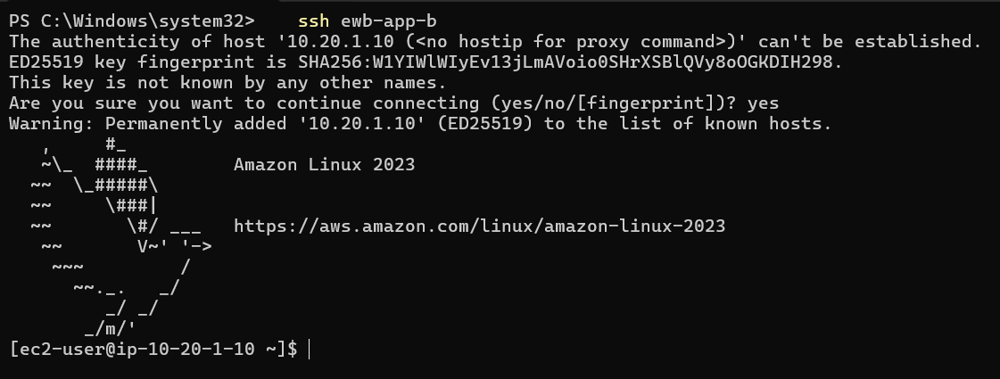
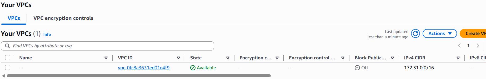

# AWS VPC Peering Lab (EWB Project 01)

Connect two VPCs with VPC peering and prove private connectivity between two private EC2 instances, using a bastion host for administration.

- **Author:** Jinu G Mathew
- **Batch:** AWS CLOUD INTERNSHIP (EWB Courses, AWS Architect Associate)
- **Region:** Asia Pacific (Mumbai) / ap-south-1
- **Completed:** 21-10-2026
- **Full report:** [report/Jinu_G_Mathew_EWB_VPC_Peering.pdf](report/Jinu_G_Mathew_EWB_VPC_Peering.pdf)

## What this project shows

- Planning non-overlapping VPC and subnet CIDRs
- Public and private subnets with explicit route table associations
- A VPC peering connection with routes on both sides
- Security groups that allow only the required inbound traffic (no `0.0.0.0/0` for SSH or ICMP)
- A failed test before peering, successful tests after, and a controlled failure and recovery
- Full cleanup of every resource

## Architecture

Administration path: laptop > bastion > App-A or App-B using SSH `ProxyJump`.
Project traffic: App-A <> App-B over private IPs through the peering connection. VPC B has no internet gateway.

## Address plan

| Resource | VPC / subnet | CIDR / address |
|---|---|---|
| ewb-vpc-a | VPC A | 10.10.0.0/16 |
| ewb-a-public | VPC A, public subnet | 10.10.1.0/24 |
| ewb-a-private | VPC A, private subnet | 10.10.2.0/24 |
| ewb-vpc-b | VPC B | 10.20.0.0/16 |
| ewb-b-private | VPC B, private subnet | 10.20.1.0/24 |
| ewb-bastion | ewb-a-public | 10.10.1.10 + public IPv4 |
| ewb-app-a | ewb-a-private | 10.10.2.10, no public IP |
| ewb-app-b | ewb-b-private | 10.20.1.10, no public IP |

Other resources: internet gateway `ewb-igw-a` (VPC A only), route tables `ewb-rt-a-public`, `ewb-rt-a-private`, `ewb-rt-b-private`, security groups `ewb-sg-bastion`, `ewb-sg-app-a`, `ewb-sg-app-b`, peering connection `ewb-a-b-peer`, key pair `ewb-lab`.

## Route tables

| Route table | Destination | Target | Purpose |
|---|---|---|---|
| ewb-rt-a-public | 10.10.0.0/16 | local | VPC A traffic |
| ewb-rt-a-public | 0.0.0.0/0 | internet gateway | Bastion internet access |
| ewb-rt-a-public | 10.20.0.0/16 | peering | Bastion SSH to App-B |
| ewb-rt-a-private | 10.10.0.0/16 | local | VPC A traffic |
| ewb-rt-a-private | 10.20.0.0/16 | peering | App-A to VPC B |
| ewb-rt-b-private | 10.20.0.0/16 | local | VPC B traffic |
| ewb-rt-b-private | 10.10.0.0/16 | peering | Return path to VPC A |

## Security group rules (inbound)

| Security group | VPC | Rule |
|---|---|---|
| ewb-sg-bastion | A | SSH TCP 22 from my public IP /32 |
| ewb-sg-app-a | A | SSH TCP 22 from 10.10.1.10/32 (bastion); ICMP Echo Request from 10.20.1.10/32 (App-B) |
| ewb-sg-app-b | B | SSH TCP 22 from 10.10.1.10/32 (bastion); ICMP Echo Request from 10.10.2.10/32 (App-A) |

Outbound rules were left at the default (allow all). Security groups are stateful, so replies are allowed automatically.

## Build steps

1. Create `ewb-vpc-a` (10.10.0.0/16) with a public and a private subnet, an internet gateway, and two route tables with explicit subnet associations.
2. Create `ewb-vpc-b` (10.20.0.0/16) with one private subnet and a route table. No internet gateway.
3. Create the three security groups and the `ewb-lab` key pair.
4. Launch three Amazon Linux 2023 instances (t2.micro) with fixed private IPs. Only the bastion gets a public IPv4.
5. Configure SSH with `ProxyJump` (see [templates/ssh-config.example](templates/ssh-config.example)) and capture the baseline ping.
6. Create the peering connection, accept it, and add the three peering routes.
7. Run the validation tests, then the controlled failure and recovery.
8. Terminate the instances and delete every resource.

## Test results

| Test | Where / command | Result |
|---|---|---|
| 01 Baseline | App-A: `ping -c 4 10.20.1.10` (before peering) | 100% packet loss |
| 02 Forward path | App-A: `ping -c 4 10.20.1.10` (after routes) | 4 replies, 0% loss |
| 03 Reverse path | App-B: `ping -c 4 10.10.2.10` | 4 replies, 0% loss |
| 04 Private SSH | Laptop: `ssh ewb-app-b` | Shell on App-B through the bastion |
| 05 Isolation | EC2 instance details | No public IPv4 on App-A or App-B |

Baseline (before peering):

Forward path (after peering and routes):

Reverse path:

SSH to App-B through the bastion:

## Controlled failure and recovery

Removing only the ICMP Echo Request rule from `ewb-sg-app-b` made the ping fail (100% loss) even though peering and routes were unchanged. Restoring the same rule brought the replies back (0% loss). This shows that Active peering is only the link: routes and security group rules decide whether traffic flows.

| Step | Screenshot |
|---|---|
| ICMP rule removed | [37](screenshots/37_failure-sg-app-b-icmp-removed.png) |
| Ping fails | [38](screenshots/38_failure-ping-fails.png) |
| Rule restored | [39](screenshots/39_recovery-sg-app-b-rule-restored.png) |
| Ping succeeds | [40](screenshots/40_recovery-ping-succeeds.png) |

## Forward and return path

- **Forward:** App-A sends to 10.20.1.10. `ewb-rt-a-private` matches 10.20.0.0/16 and sends the packet through the peering connection. `ewb-sg-app-b` allows ICMP Echo Request from 10.10.2.10/32.
- **Return:** App-B replies to 10.10.2.10. `ewb-rt-b-private` matches 10.10.0.0/16 and sends the reply back through the peering connection.

## What I learned

- Peering is only the link. Both VPCs need routes to each other's CIDR, and the destination security group must allow the traffic.
- A route's destination is always the other VPC's range. AWS rejected my first attempt because I used VPC B's own range in a VPC B route table.
- The bastion's public subnet needs the peering route too, so SSH through `ProxyJump` can reach App-B.
- My public IP changed during the lab, so the bastion's /32 rule had to be updated.
- The account could not launch T2 instances with Unlimited CPU credits, so I used Standard.
- Consistent names and tags made cleanup easy to verify. I terminated the instances right after testing to keep costs minimal.

## Cleanup

All resources were removed after testing: instances (and volumes), peering routes and the peering connection, security groups, subnets, route tables, internet gateway, both VPCs, and the key pair. See screenshots [41](screenshots/41_cleanup-instances-terminated.png) to [50](screenshots/50_cleanup-key-pairs.png). Only the account's default VPC resources remain.

## Repository contents

| Path | What it is |
|---|---|
| `report/` | Full project report (PDF) |
| `docs/architecture.png` | Architecture diagram |
| `screenshots/` | Numbered evidence screenshots, in build order |
| `templates/ssh-config.example` | SSH config with `ProxyJump` (placeholder IP) |

## Privacy note

Screenshots in this repository have the AWS account ID and my public IP address hidden. No private key, password or access token is included, and `.pem` files are excluded by `.gitignore`.
